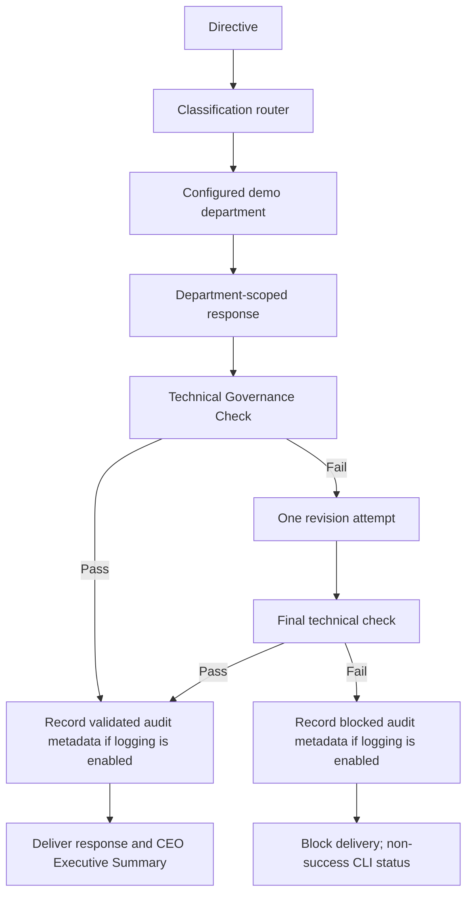

 Mission Control OS™

> **Most AI systems begin with agents. Mission Control OS™ began with governance.**

Mission Control OS™ is a governance-first AI executive operating system for founders and knowledge-driven organizations. It transforms executive directives, conversations, meetings, and organizational knowledge into coordinated, decision-ready intelligence.

**Built for leverage. Not busywork.**

[View the public project experience](https://mission-control-os.cjmoneyway.chatgpt.site)

## Inspiration

Mission Control OS™ grew from a challenge I experience every day as founder and CEO of CJ Moneyway Media™. Founders and small organizations constantly move between strategy, operations, marketing, research, publishing, relationships, and execution. Important decisions become scattered across conversations, documents, meeting notes, and disconnected AI tools.

I wanted to answer a different question:

> **What if AI could prepare an organization for its people instead of replacing them?**

The project applies AI to organizational preparation: documenting departments, routing work, preserving knowledge, supporting executive review, and giving future employees an established operating environment.

## What it does

Mission Control OS™ organizes work through specialized executive and departmental roles rather than one general-purpose assistant. The prototype architecture is designed to:

1. Receive an executive directive.
2. Classify the request.
3. Select the appropriate department or specialist.
4. Execute inside a defined specialist context.
5. Prepare a CEO Executive Summary.
6. Preserve minimized execution metadata when audit logging is enabled.
7. Surface the next decision or action.

Potential outputs include CEO Executive Summaries, leadership insights, Moneyway Journal™ executive articles, content-repurposing opportunities, relationship intelligence, follow-up recommendations, partnership opportunities, operational action plans, and searchable organizational knowledge.

## Governance-first architecture

| Layer | Purpose |
|---|---|
| **1. Philosophy** | Mission, values, brand identity, and fixed organizational principles |
| **2. Governance** | Decision filters, escalation, reporting, brand alignment, knowledge preservation, and human review |
| **3. Intelligence** | Classification, departmental routing, specialist contexts, executive summarization, and revision handling |
| **4. Execution** | Articles, reports, recommendations, relationship intelligence, logs, and human-assigned work |

## Primary demonstration

The Build Week narrative illustrates how a podcast conversation could support enterprise intelligence. The offline demo produces a deterministic routing and recommendation template; it does not process a real conversation or create the downstream assets listed below. The intended workflow could support:

- A Moneyway Journal™ executive article
- Podcast release materials
- Leadership insights
- Content-repurposing opportunities
- Relationship and follow-up intelligence
- Partnership opportunities
- Operational recommendations
- A CEO Executive Summary
- A principle preserved for the Moneyway Principle Archive™

> **Create Once. Publish Everywhere. Build Forever.™**

## How Codex was used

Codex served as the **technical formalization and implementation layer** for Mission Control OS™. It helped translate founder experience and documented governance into:

- Technical architecture
- Python prototype structures
- Router and specialist workflow logic
- Structured system prompts
- Department-specific instructions
- JSONL audit-log design
- Repository and README documentation
- Capability-status and evidence matrices
- Test and verification requirements
- Devpost submission assets

Codex was also used to separate verified functionality from validation-required and roadmap capabilities so the public submission would not overstate what was operational.

## How GPT-5.6 was used

GPT-5.6 served as a reasoning and organizational-intelligence layer during Build Week. It was used to:

- Interpret executive directives
- Develop and refine governance standards
- Clarify department mandates and boundaries
- Structure executive and specialist roles
- Preserve the founder’s voice across formats
- Generate decision-ready summaries
- Identify cross-department implications
- Refine the Build Week narrative
- Review claims for evidence, privacy, and consistency

The model relationship is:

```text
Founder experience
        ↓
Documented governance
        ↓
GPT-5.6 organizational reasoning
        ↓
Codex technical formalization
        ↓
OpenAI API prototype execution
        ↓
Human leadership and review
```

## OpenAI implementation

- **ChatGPT / GPT-5.6:** Organizational reasoning and governance-development environment
- **Codex:** Technical formalization, implementation support, documentation, and verification structure
- **OpenAI API:** Optional Responses API provider; transmission is denied without trusted authorization and sensitive-data clearance
- **Python:** Prototype runtime
- **JSONL:** Minimized audit metadata; full successful records are available separately through CLI JSON output

## Capability status

Mission Control OS™ uses three evidence classifications:

- **BUILT AND VERIFIED** — supported by code, logs, screenshots, tests, a working link, or a recorded demonstration.
- **BUILT — VALIDATION REQUIRED** — present in the implementation or project materials but awaiting complete technical proof.
- **ROADMAP — NOT OPERATIONAL** — designed or planned, but not presented as working.

| Capability | Current classification |
|---|---|
| Public landing page | **BUILT AND VERIFIED** |
| Project narrative and four-layer governance architecture | **BUILT AND VERIFIED** |
| Python prototype | **BUILT AND VERIFIED** |
| Deterministic offline classification and specialist execution | **BUILT AND VERIFIED** |
| OpenAI API classification and specialist execution | **BUILT — VALIDATION REQUIRED** |
| Department routing and department-scoped prompt contexts (offline behavior) | **BUILT AND VERIFIED** |
| CEO Executive Summary generation | **BUILT AND VERIFIED** |
| Minimized JSONL audit metadata and non-destructive retention views | **BUILT AND VERIFIED** — local POSIX tests |
| Technical Governance Check, one revision attempt, and blocked final rejection | **BUILT AND VERIFIED** — limited structural and secret-pattern checks |
| Engine and OpenAI provider default-deny clearance | **BUILT AND VERIFIED** — synthetic tests; no live API validation |
| Synthetic registry, approval, work-packet, and lifecycle contracts | **BUILT AND VERIFIED** — validation scaffolding; no operational registry or live lifecycle |
| Automated HubSpot, Google Drive, and Google Sheets writeback | **ROADMAP — NOT OPERATIONAL** |
| Full enterprise dashboard and cross-platform synchronization | **ROADMAP — NOT OPERATIONAL** |

## Repository security

Never commit:

- `.env` files
- API keys or access tokens
- Passwords or credentials
- Private CRM exports
- Confidential guest information
- Private email, calendar, Drive, or Sheets data
- Unsanitized execution logs

## System architecture



The default `mock` provider runs deterministically without network access or paid
API calls. The engine requires authorization and sensitive-data clearance before
each custom/injected provider classification, execution, and revision call. Only
the exact internally constructed mock is exempt; injecting a mock object does not
inherit that exemption. Missing, denied, malformed, or failing clearance blocks
the call. The optional OpenAI provider also checks its exact outbound payload
before calling the Responses API.

Department-scoped contexts supply a selected mandate and, for the OpenAI provider,
department-specific prompt instructions. They provide no process sandbox, separate
security principal, or data-access isolation. The mock provider produces a fixed
recommendation template using the selected department's public configuration.

Technical governance checks look for required summary labels and two secret
patterns. They do not verify factual accuracy, comprehensive confidentiality,
brand compliance, or organizational permission. The `approved` status means only
these technical checks passed. A failed final check blocks result delivery; it
does not turn a rejected response into an approved result. Any configured audit
write must succeed before delivery; audit I/O failures also block the CLI result.

## Requirements

- Python 3.10 or newer
- No API key for the offline demo or tests
- A local POSIX filesystem with `flock`, atomic replacement, and directory-sync
  support for audit logging and retention; unsupported platforms fail closed
- Trusted programmatic authorization and sensitive-data clearance, plus an API
  key, for any separately authorized live OpenAI use

## Installation

```bash
git clone https://github.com/cjmoneyway-rgb/mission-control-os.git
cd mission-control-os
python -m venv .venv
source .venv/bin/activate
pip install -r requirements.txt
```

Windows PowerShell activation (environment activation only; audit logging and
retention require POSIX, so use `--no-log` for an offline CLI run on Windows):

```powershell
.venv\Scripts\Activate.ps1
```

The offline prototype itself uses only the Python standard library. Installing
`requirements.txt` adds the official OpenAI SDK for the optional gated provider;
installing it does not enable live access.

## Run the judge demo — free and offline

```bash
python main.py --demo
```

This routes the approved Build Week directive to the Media & Editorial Division,
executes the specialist workflow, applies the Governance Check, generates a CEO
Executive Summary, and appends minimized execution metadata to `logs/executions.jsonl`.

Run a custom request:

```bash
python main.py "Prepare a podcast guest interview and release plan"
```

Pipe the included sample request and print the complete structured record:

```bash
python main.py --json < examples/sample_request.txt
```

Disable audit logging for an ephemeral run:

```bash
python main.py --demo --no-log
```

## Phase 1A hardening

These boundaries describe merged Phase 1A commit `cf4c28a`. See
[security boundaries and unresolved decisions](docs/phase-1a-security.md) for the
full public technical notes.

### Minimized audit metadata and retention

Default audit lines contain an opaque execution ID, timestamp, technical status,
an authorization disclaimer, schema revision, revision count, and finding count.
They omit directives, response text, rejected output, department projections, and
provider-generated rationales. Route IDs require an explicit public/synthetic-only
opt-in. Successful `--json` output still includes the full in-memory record,
including the directive, department details, and response; audit minimization does
not redact terminal output or downstream captures.

Audit appends and explicit retention share a stable POSIX lock. With a configured
positive day count, `JsonlAuditLog.purge_expired()` atomically refreshes a separate
`<source>.retained.jsonl` snapshot. Despite its historical name, it never deletes,
rewrites, or reorders source audit records and does not reclaim storage. Retention
is unconfigured by default; no enterprise deletion policy is implied. Legacy or
unknown audit schemas require separate review and are refused by this operation.
Existing legacy logs are not automatically sanitized or migrated.

### Synthetic registry and lifecycle contracts

Registry validation binds approval to an exact record ID, revision, and content
digest. A trusted verifier must resolve current, matching approval evidence and
the referenced department, title, owner, and policy. Missing, unresolved, expired,
or unverifiable evidence fails closed; changing a revision invalidates its prior
approval. Technical validity alone grants no organizational authority.

These are synthetic validation contracts, not an operational registry or an
activation service. Work packets and lifecycle events must remain inactive.
Journey history is append-only in memory, with invalid transitions and duplicate
event IDs rejected; it has no durable storage or integration hooks. Confidential
operational records require a protected data store and approved identity,
permissions, and evidence authority before implementation. Those decisions remain
unresolved; no real assignments or organizational records are supplied here.

### Phase 1B–1E governed foundations

Later phases extend the same application with protected-registry contracts,
PostgreSQL persistence proofs, a revision-controlled department registry, inactive
routing, a complete 16-stage synthetic podcast-guest lifecycle and Phase 1E
production-readiness gates. See the documents in `docs/` for their exact security
boundaries. These foundations remain synthetic and inactive; they do not configure
production identity, confidential storage, operational routing or integrations.

Phase 1E requires exact current evidence for twelve production controls and binds a
proposed pilot plan to the reviewed package revision and digest. A successful
assessment reports synthetic technical readiness only. Operational authorization
is unavailable and fails closed.

## Optional OpenAI provider — default-deny

The Responses API implementation remains unverified against a live service.
Credentials alone do not authorize transmission. The CLI exposes no clearance
override, so selecting `--provider openai` cannot enable live execution, even when
an API key is present. Live CLI mode is intentionally blocked in Phase 1A.

Any separately authorized programmatic use must supply a trusted safety gate that
explicitly clears both authorization and sensitive-data review for every provider
call and outbound OpenAI payload. Do not copy the always-allow synthetic test
fixtures into production. Callbacks and evidence verifiers are trusted application
dependencies; these checks do not sandbox arbitrary Python code.

`.env.example` documents `OPENAI_API_KEY` and the optional `OPENAI_MODEL`. The CLI
does not automatically load dotenv files. Any authorized credentials must be
supplied securely and kept out of source, logs, and public documentation. No live
API call or external integration is enabled by these instructions.

## Testing

The current suite contains **277 tests**: 145 offline checks and 132 tests requiring
the reviewed disposable PostgreSQL 17.11 workflow. Tests use deterministic mocks,
synthetic identities and approvals, and a fake OpenAI SDK. They make no live API
calls and require no real credentials:

```bash
python -m unittest discover -s tests -v
```

The suite covers routing and fallback, blocked final governance, CLI rejection,
strict confidence and provider-result validation, duplicate JSON keys, exact-revision
approval and evidence failures, injected-provider bypass attempts, minimized audit
metadata, concurrent append/retention, retention failures and process interruption,
restrictive file modes, invalid lifecycle transitions, and duplicate event IDs.
Later tests also cover PostgreSQL isolation, concurrency, complete archive/restore,
the 16-stage synthetic guest lifecycle, exact readiness evidence and the inactive
pilot-authorization plan.
Passing these tests does not authorize external processing or operational routing.

## Repository map

```text
mission-control-os/
├── main.py                         # CLI; blocks rejected delivery
├── requirements.txt                # Optional OpenAI SDK dependency
├── requirements-dev.txt            # Development dependency entry point
├── .env.example                    # Variable names; no real credentials
├── mission_control/
│   ├── __init__.py                 # Public package entry point
│   ├── engine.py                   # Provider clearance, routing, review, delivery
│   ├── providers.py                # Offline mock and gated OpenAI provider
│   ├── governance.py               # Limited technical output checks
│   ├── audit.py                    # Metadata log and non-destructive retention view
│   ├── config.py                   # Validated public department projections
│   ├── models.py                   # Execution and routing data contracts
│   ├── contracts.py                # Synthetic registry, approval, and lifecycle
│   ├── readiness.py                # Phase 1E evidence and pilot-authorization gates
│   ├── json_io.py                  # Strict JSON; rejects duplicate keys
│   └── departments.json            # Public demo catalog; not a private registry
├── docs/
│   ├── phase-1a-security.md         # Initial hardening boundaries
│   ├── phase-1d-synthetic-podcast-pilot.md # Complete inactive pilot proof
│   └── phase-1e-production-readiness.md # Pre-provisioning gates and decisions
├── examples/
│   └── sample_request.txt          # Public demonstration directive
└── tests/
    ├── __init__.py
    ├── test_cli.py                 # Offline CLI checks
    ├── test_engine.py              # Routing, review, and audit behavior
    ├── test_openai_provider.py     # Fake SDK contract; no live API validation
    ├── test_hardening.py           # Phase 1A fail-closed regressions
    ├── test_production_readiness.py # Phase 1E evidence and launch-denial tests
    ├── test_precommit_corrections.py # Concurrency, evidence, parsing, provider gates
    └── hardening_support.py        # Synthetic test authorities and clearance
```

## Current verification boundary

The offline CLI, synthetic PostgreSQL architecture, registry/routing contracts,
inactive podcast lifecycle, complete synthetic archive and Phase 1E readiness gates
are covered by the 277-test suite. Technical checks and synthetic evidence do not
establish enterprise authorization, production data isolation, factual correctness
or permission to admit confidential records.

Live OpenAI execution remains **BUILT — VALIDATION REQUIRED** and default-deny;
an API key alone does not change that boundary. No operational approval authority,
confidential registry, production lifecycle routing, or guest pilot is activated.
External CRM/Drive/Sheets writeback and the unified dashboard remain
**ROADMAP — NOT OPERATIONAL**. Provider selection, purchasing, provisioning,
production identity/key custody, confidential data admission and pilot launch each
require separate authorization; this documentation grants none of them.

## What we learned

A multi-agent system needs more than multiple agents. It needs shared principles, defined responsibilities, evidence standards, escalation rules, organizational memory, and human accountability.

> **Mission Control OS™ does not use AI to remove people from the organization. It uses AI to prepare the organization for its people.**

AI prepares.  
People lead.  
Organizations grow.

## Roadmap

- Verify and approve the production provider, identity, custody and recovery design
- Provision an isolated environment and repeat all tests with synthetic data
- Authorize and run one bounded, human-controlled confidential pilot
- Deeper organizational memory
- Additional executive and departmental specialists
- CRM and relationship-management integration
- Controlled Google Drive and Google Sheets actions
- Human onboarding and department-development tools
- A unified executive dashboard
- Expanded audit and decision-trail capabilities

## Builder

**Corwin “CJ Moneyway” Johnson**  
Founder & CEO, CJ Moneyway Media™  
Host, The CJ Moneyway Show™

- [CJ Moneyway Media™](https://cjmoneyway.com)
- [The CJ Moneyway Show™](https://pod.link/1707761906)
- [LinkedIn](https://www.linkedin.com/in/corwin-johnson-3b7b51aa)
- [Mission Control OS™](https://mission-control-os.cjmoneyway.chatgpt.site)

## Final operating statement

Mission Control OS™ does not replace executive judgment. It creates a governed structure for routing work, applying departmental intelligence, reviewing outputs, preserving institutional memory, onboarding people, and preparing decision-ready information for executive leadership.

**Proceed Brick by Brick™.**  
**Built For Purpose™.**  
**Faith • Vision • Legacy™.**
