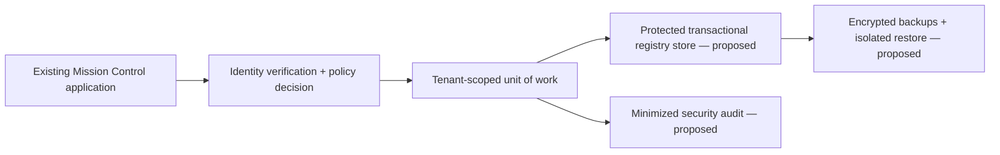

# Phase 1B: Protected Registry and Authorization Foundation

Status: **PROPOSED FOR CEO REVIEW — UNCOMMITTED, SYNTHETIC, INACTIVE**.
Baseline: `d57aac6`, current main when this branch was created; it merges the
Phase 1A documentation correction. This extends the existing Python package and
reuses its RegistryRecord, ApprovalVerifier, WorkPacket, and LifecycleEvent
contracts. It creates no second Mission Control application, new CLI, integration,
production configuration, or active routing path.

## 1. Protected-storage requirements and architecture

Recommend a transactional relational store, with PostgreSQL as the preferred
candidate for later evaluation, behind the existing application's service boundary.
A database or provider has NOT been selected or connected by this change.
PostgreSQL row-level security can reinforce tenant isolation, but application
policy checks and restricted database roles remain required. No database adapter,
SQL runner, connection string, driver, infrastructure, or new dependency is added.

All arrows are proposed boundaries. The foundation interfaces are not wired to
the CLI, engine, or external provider. Public code may contain types, validation,
logical migrations, and synthetic examples. Confidential records, labels, title
mappings, assignments, access policies, source attachments, and approval proofs
belong in the protected store or an encrypted object store with access-controlled
opaque references. A private repository may hold confidential design; it does
not replace an operational access-controlled store.

Require encryption in transit and at rest, managed keys with independent access,
least-privilege service accounts, secret-manager bindings, tenant-scoped access,
network isolation, monitored access, and a separate restricted migration identity.
Logging, errors, observability, snapshots, exports, and backups must obey the same
classification boundaries. Reference-only metadata can still be sensitive. Do
not put tokens, personal identifiers, full packets, or approval proof bodies in
application logs. None of these operational protections is claimed implemented.

## 2. Authenticated identity and approval authority

`IdentityVerifier.resolve_session` is the trusted boundary. It must resolve an
opaque session reference using authenticated context. A future adapter must
verify signature/issuer/audience, allowed algorithms, expiry/not-before, session
revocation, tenant membership, and current roles. Caller-supplied principal or role
JSON is never authentication. Use short-lived sessions, MFA for privileged human
approval, and separately managed service identities; exact assurance requirements
remain UNRESOLVED. No JWT parsing or identity-provider connection is shipped.

The pure evaluator accepts only matching tenant/audience, current validity,
explicitly non-revoked identity, and trusted current policy. Exceptions and missing
adapters produce a denied decision. A synthetic permission decision is not a
capability token or approval and cannot be passed to bypass transactional checks.

Reuse the Phase 1A ApprovalVerifier/ApprovalEvidence projection. The future tenant-
scoped authority must resolve proof reference, exact record ID/revision/digest,
authenticated grantor, current grantor permissions, policy revision, validity, and
revocation. Deny self-approval where separation of duties is required; determining
that scope and approved delegation/emergency processes is a CEO decision. Issue
and revoke evidence in authenticated transactions with minimized audit evidence.
No approval issuer or real proof store is implemented; boolean self-attestation
and a synthetic role are insufficient. Revalidate on use: an old approval cannot
activate an edited revision or bypass expiry/revocation. Evidence's tenant scope
must be enforced by the authority, since the Phase 1A projection itself has no
tenant field.

## 3. Role- and policy-based permissions

All roles below are generic technical placeholders; none assigns real people.

| Candidate role | Candidate permission, only after explicit policy grant |
|---|---|
| registry_reader | Read an exact synthetic registry resource |
| registry_editor | Append a draft revision to an exact resource |
| packet_editor | Append an inactive packet revision |
| journey_recorder | Append an inactive synthetic journey event |
| approval_reviewer | Proposed later evidence review; no grantable approval action now |
| security_auditor | Proposed minimized audit inspection under a separate policy |

Implemented action vocabulary is limited to registry/packet/journey read and
inactive append operations. Policy rules bind role, exact resource, action, and
allow/deny effect. No resource wildcard is accepted. Explicit deny overrides
allow across roles. No matching grant, stale policy revision, wrong tenant,
expired identity/policy, revoked identity, malformed claims, or unavailable
verifier denies access. Activation, integration use, external provider access,
and approval issuance cannot be granted by this evaluator. No policies or roles
are seeded into an operational system. Default construction has no authorities.

A future adapter must also enforce field-level visibility, resource classification,
current assignments, and tenant isolation before reads, writes, and replay returns.
These policies are UNRESOLVED, so the current synthetic evaluator cannot be used
for confidential access. Do not accept policy snapshots from request payloads.
Policy revisions must be immutable; revocations and role removals must invalidate
current access. Policy caching needs bounded expiry and revocation behavior before
any operational use.

## 4. Versioned Canonical Department Registry

`RegistryRevision` wraps the existing RegistryRecord with tenant, schema revision,
dataset marker, previous revision, and checked content digest. Only synthetic
`draft` or `inactive` records are accepted. State changes cannot activate routing.
The registry digest covers RegistryRecord.payload(), excluding the approval
wrapper to avoid circular approval hashes; evidence binds this same payload digest.
Tenant and schema scope are checked separately by the transaction and envelope.
Revisions are immutable, sequential, and addressed by `(tenant, record, revision)`;
a separate head advances using compare-and-swap. New revision N requires head N-1.
A matching approval on one revision does not authorize the next. New titles,
ownership, permissions, and activation gates remain UNRESOLVED.

The first migration defines versioned payload storage and references, not a
complete confidential organization model. Names, aliases, mandates, and internal
assignments must be added through separately reviewed protected-schema revisions,
not public seed data. Tenant-scoped authorities must resolve all required
references before any later approved operational state could be considered.
Store schema version and canonical digest algorithm alongside rows. Python
canonical JSON hashing is currently a single-language contract; any cross-language
adapter must standardize and test canonicalization before sharing signatures.
Digests bind content but are not signatures or tamper-proof audit evidence.

## 5. Durable event and work-packet persistence design

`PacketRevision` pins an exact registry revision and tenant and requires opaque
source, purpose, and policy references. It reuses inactive WorkPacket validation.
Source details, actions, priorities, timezone-aware deadlines, classification,
confidentiality, return status, dependencies, outcome fields,
and restricted attachments require a protected, versioned packet payload and
approved visibility rules; they are not populated here. The schema's payload
column reserves that protected contract without inventing real ownership.

`JournalEvent` wraps the existing inactive LifecycleEvent with tenant, sequence,
predecessor digest, schema revision, and an exact packet revision. A pure append validator enforces synthetic transitions
new -> received -> prepared -> completed, contiguous sequence, correct predecessor,
packet reference, and tenant/journey identity. These are test states, not an
approved business lifecycle. Preserve every accepted journey event; current-state
views derive from history and must not erase entry origin or earlier outcomes.

A future adapter must commit event, head advance, idempotency receipt, and required
security audit as one durable transaction. No event delivery, outbox dispatcher,
network action, or pilot exists. Histories are durable only when a reviewed adapter
is implemented and tested; current validators alone provide no persistence.

## 6. Transactions, migrations, idempotency, and recovery

`ProtectedRegistryStore.transaction(tenant, session, policy_revision)` returns a
tenant-scoped RegistryTransaction. Exit without explicit commit must roll back.
Validate identities, exact policy revision, and object permissions inside the unit
of work. Recheck expiry/revocation before commit; fail on authority outages. Bound
transaction duration and trusted clock behavior must be specified by the adapter.
Read/check/write and head CAS must be atomic, using appropriate row locks or
serializable isolation plus unique constraints. Never implement head updates as
unlocked read-then-write. Tenant scope is mandatory on every lookup and composite
foreign key, including approval evidence and duplicate-event lookups.

For each write, bind idempotency receipt to tenant, operation, key, canonical request
digest, and result reference/revision. Equal key+digest is a replay with no second
append; changed payload is a conflict. Reauthenticate and authorize on retries;
a receipt cannot leak a previous caller's result. Reserve receipt and mutate rows
in the same transaction; never mark success before commit. Unique event ID within
a tenant and unique journey sequence arbitrate concurrent duplicate writers. Retry
only serialization/deadlock/transient failures with bounded backoff; a lost commit
acknowledgement requires receipt lookup, not blind replay. Never suppress a conflict.

`migrations/protected_registry/0001_foundation.json` is a **backend-neutral logical
migration**, not executable SQL or an applied database migration. It contains no
seed records. Its validator rejects duplicate JSON keys, unknown types/rules,
non-synthetic scope, invalid keys, and foreign keys without matching tenant keys.
The validated plan has an immutable canonical document and checksum.

| Entity | Purpose |
|---|---|
| schema_migrations | Applied migration ID, checksum, and timestamp |
| subjects, role_bindings | Opaque authenticated subject mappings and bounded role grants |
| policy_revisions | Immutable policy rules, digest, and validity |
| registry_revisions, registry_heads | Immutable registry revisions and CAS pointer |
| approval_evidence, approval_revocations | Revision-bound proofs and append-only revocation evidence |
| packet_revisions, packet_heads | Exact registry references, immutable packets, CAS pointer |
| journey_events, journey_heads | Durable ordered history and CAS sequence pointer |
| idempotency_receipts | Transactional replay identity and result reference |
| security_decisions | Minimized authorization outcomes, actor/policy references, timestamp |

Every entity has a synthetic dataset discriminator. Logical rules must be mapped
into actual DB constraints/triggers/privileges in a later reviewed adapter:
synthetic dataset checks, draft/inactive states and active=false, positive revisions,
valid intervals, insert-only history, tenant isolation, and CAS. Columns are
required except nullable predecessor digest on the first event. Dynamic transitions,
approval trust, proof revocation, and authorization also need service enforcement
inside transactions. The logical validator verifies schema structure, not SQL
constraint enforcement or an authenticated grantor. No physical mapping is approved.

Apply future migrations under an exclusive migration lock, with checksum ledger,
preflight validation, isolated backup, schema compatibility checks, and transactional
DDL where supported. Reapplying the same ID+checksum is a no-op; changed checksum
is a hard failure. There is no destructive down migration. Recovery must use a
reviewed forward fix or isolated restore, never silent history rewrite. Expand/
contract changes need compatibility tests and a separately authorized rollout.

Require encrypted full backups and transaction-log/PITR support, isolated backup
credentials, key recovery, access audits, and regular restore drills. Define CEO-
approved RPO/RTO, restore frequency, cross-region policy, and retention before use.
An isolated restore must verify migration checksums, row counts, tenant boundaries,
revision/digest chains, packet/event references, idempotency receipts, and current
revocations. Replay must never trigger external actions. Do not restore stale role
grants into active access without revalidation. None of these operations runs here.

Retention must distinguish operational revisions, identity/session metadata,
approval evidence, security audits, backups, and derived views. Legal holds and
approved retention durations are UNRESOLVED. Preserve history by default. Phase 1A
retention remains a non-destructive view, not a storage cleanup policy. Event
redaction/erasure or evidence disposal requires separately approved tombstone and
recovery semantics; do not invent deletion periods or cascade-delete histories.

## 7. Legacy-log inventory and quarantine plan

Existing local legacy logs are ignored, not tracked. The read-only inventory in
this task checks file count, sizes, restrictive access, content fingerprints, and
modification times without printing payloads. No files are moved, deleted, copied
into this repository, sanitized, passed through retention, or otherwise altered.
Actual inventory results are reported in the task, not committed as operational
metadata. Public documents contain only this generic plan.

Separately authorized sequence: identify originals, rotated files, exports,
snapshots, and backups; record checksums and provenance in a protected inventory;
review sensitivity/holds/access; copy verified originals into encrypted protected
quarantine with restricted access; compare hashes and preserve immutable originals;
review a migration that creates a separate minimized copy. Reconcile counts,
references, failures, and retention decisions before any disposal. Quarantine is
a controlled copy, not a branch, public commit, destructive move, or deletion.
Never print payloads to chat or CI. Unknown/malformed rows remain quarantined for
review instead of being silently dropped. No quarantine operation is authorized here.

## 8. Threat model and security test plan

Assets: registry/packet contents, identities, policies, approval proofs, journey
history, audit references, encryption keys, backup data, and idempotency results.
Trust boundaries: caller -> identity verifier -> policy authority -> unit of work
-> storage; storage -> backups; migration identity -> schema. Public source and
synthetic fixtures must not become a path to operational authority.

| Threat | Required control | Coverage in this change / later adapter gate |
|---|---|---|
| Forged identity or role escalation | Trusted resolution, audience/tenant/expiry/revocation checks | Synthetic deny/allow and malformed authority tests; real IDP cryptography deferred |
| Cross-tenant references or ID guessing | Tenant-scoped auth, composite keys, least disclosure | Contract and manifest tests; real RLS/query isolation deferred |
| Stale policy, approval reuse, self-approval | Exact revision/digest, current authority, separation of duties | Existing Phase 1A evidence tests plus stale policy tests; issuer workflow deferred |
| Confused deputy/external activation | Inactive action allowlist; no engine/adapter wiring | Forbidden-action and inactive state tests; no external calls |
| Lost update, duplicate delivery, changed-payload retry | CAS + unique keys + transactional receipts | Pure stale-chain and collision tests; real concurrent DB transaction tests deferred |
| Rollback, disk failure, partial commit, lost acknowledgement | Atomic unit of work, receipt lookup, durable storage | Interface requirements only; fault-injection/crash-recovery adapter tests required |
| History or migration tampering | Immutable revisions, checksum ledger, restricted migration role | Digest/schema mutation tests; DB permissions and migration ledger integration deferred |
| Sensitive payload leakage | Protected storage, opaque references, minimized logs/errors | Generic denied diagnostics and synthetic fixtures; production leakage tests deferred |
| Backup compromise or stale authorization restore | Encrypted restricted backups, key separation, restore revalidation | Architecture requirement; isolated restore drills required before production |
| Authority outage or clock expiry | Deny on outage, bounded validity, recheck at commit | Synthetic expiry/outage tests; operational availability tests deferred |

Do not mistake pure validation tests for DB durability or cryptographic identity
verification. Before any operational adapter is approved, require independent
transaction rollback, two-writer CAS/idempotency races, connection loss before/
after commit, revoked evidence during transactions, SQL injection, row-level
visibility, cross-tenant read/write/replay, real migration reapplication, backup
restore/PITR, and retention/hold tests against an isolated synthetic instance.

## 9. Dependencies, decisions, risks, and implementation sequence

No new dependencies are required for these pure interfaces/validators. A later
adapter will need a reviewed DB driver, migration tooling, authenticated identity
and approval verifiers, key/secret management, and infrastructure. Do not add them
or provision services under this change. Phase 1A engine and provider safety gates
remain intact; registry permission does not authorize model transmission.

CEO decisions remain UNRESOLVED: storage provider/location and tenancy boundary;
identity issuer/audience and privileged assurance; approver authority/delegation
and separation of duties; canonical titles and ownership; field visibility and
classification; policy administrators; retention/holds; backup ownership/RPO/RTO;
operational lifecycle and packet requirements; and any future pilot authorization.
Risks include stale authorization caches, incorrect tenant filters, relying only
on application checks instead of DB constraints, untested canonicalization,
restoring revoked permissions, reference metadata leakage, and mistaking logical
migrations for an implemented persistence layer.

Recommended sequence, each with separate review as appropriate:

1. Review these sanitized contracts and logical migration; resolve foundational
   storage/identity/permission decisions without entering real records.
2. Select an isolated synthetic storage target and map logical constraints into
   a reviewed backend migration; prove all deny defaults and tenant boundaries.
3. Implement one unit-of-work adapter and an authenticated identity/evidence adapter;
   exercise crash, concurrency, idempotency, migration, and backup restore gates.
4. Review protected data handling and approval issuance/revocation design; only
   then consider authorized integration with the existing application boundary.
5. Request separate authorization before any confidential data, production change,
   external integration, operational routing, or guest pilot.

This branch is not approval to perform steps 2–5. No commit, push, merge, deployment,
environment publication, production modification, or pilot is part of this work.

## Validation of this proposal

The offline suite contains 53 tests: the existing 37 Phase 1A tests plus 16 new
synthetic foundation tests. Run `python -m unittest discover -s tests -v` from the
existing checkout. No new third-party dependency, database instance, service,
confidential fixture, or migration application is needed. These tests verify pure
contracts and logical schema structure; they do not prove database durability,
transaction isolation, production identity verification, or backup recovery.
