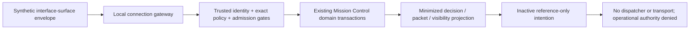

# Phase 2A: local synthetic internal connection layer

Review baseline: `9591e432790539efc06f77e6e21ee4fcd0e5a0ad`, the verified Phase 1
closeout main commit. Branch: `phase-2a/internal-connection-layer`. Changes remain
uncommitted for CEO review. This extends the existing Mission Control OS™ package;
it creates no second operating system, operational pilot or hosted environment.

## Current-system connection audit

The Phase 1 [closeout](phase-1-closeout-release-candidate.md) records the existing
architecture and authority limits. These modules are reused **unchanged**:

| Concern | Existing implementation | Connection use |
|---|---|---|
| Registry and routing | [department_routing.py](../mission_control/department_routing.py), [routing_postgres.py](../mission_control/routing_postgres.py) | Existing strict decoders, approved rule/department resolution, pure packet derivation, immutable packet revisions and scoped projections |
| Lifecycle / packets | [podcast_pilot.py](../mission_control/podcast_pilot.py), [pilot_postgres.py](../mission_control/pilot_postgres.py) | Start, propose, advance and read the existing inactive synthetic journey; no duplicate lifecycle or packet store |
| Identity / policy | [synthetic_identity.py](../mission_control/synthetic_identity.py), [registry_authorization.py](../mission_control/registry_authorization.py) | Reuse trusted synthetic sessions, current policy, tenant/MFA/service claims, exact grants and deny precedence |
| Transactions / evidence | [synthetic_postgres.py](../mission_control/synthetic_postgres.py) and existing routing/pilot transactions | Existing approval proof, revocation, serializable commit/recheck, rollback, CAS, audit and idempotency mechanisms |
| Audit | [audit.py](../mission_control/audit.py) and transactional security decisions | Existing domain audit remains intact; gateway adds a reference-only admission audit interface, never writes the legacy log |
| Archive | [pilot_archive.py](../mission_control/pilot_archive.py), [pilot_archive_integrity.py](../mission_control/pilot_archive_integrity.py) | Existing 34-table export/restore and reconciliation, including connection-originated domain writes; no schema or archive change |
| Governance | [governance.py](../mission_control/governance.py) | Review trusted synthetic fixture artifacts; return only passed/finding-count metadata, never artifact text |
| Readiness | [readiness.py](../mission_control/readiness.py) | Assess separately configured tenant/package evidence; never receive evidence authority from a request |
| Existing CLI / provider | [engine.py](../mission_control/engine.py), [providers.py](../mission_control/providers.py) | Unchanged and not invoked by this gateway. No gateway route transmits a directive to a provider |

The declared dependencies are the OpenAI client and development PostgreSQL driver.
No HTTP server framework exists in the dependency set. A framework, duplicate
registry, new database or automatic migration is unnecessary for this phase.
The smallest safe boundary is a standard-library **in-process gateway** with
HTTP-shaped methods/paths and backend-neutral service/rate/audit interfaces.
It binds no socket, starts no HTTP listener, and adds no runtime dependency.

## Architecture and governed flow

Interface Surface → Connection Layer → Identity/Policy Gate → Mission Control
Domain Services → Work Packet/Decision/Visibility Projection → Inactive Outbox.

ChatGPT departmental environments, CEO Command Center, dashboards, Slack, HubSpot,
email, calendar, documents and publishing are future communication/execution
surfaces. They do not become the operating system or an authority over Mission
Control policy. A source label is a synthetic claim bound to a verified fixture
context, not evidence of a real application connection.

Implementation:

- [connection_contracts.py](../mission_control/connection_contracts.py): strict
  v1 envelopes, domain decoder reuse, route/payload inventory, connector/outbox and
  Command Center schemas, bounded minimized projections.
- [connection_gateway.py](../mission_control/connection_gateway.py): opt-in
  `Gateway.handle(method, path, encoded_envelope, trusted_context)`, default-deny
  dependencies, admission/rate/budget checks and sanitized responses.
- [connection_services.py](../mission_control/connection_services.py): thin adapter
  to existing Phase 1 services. It contains no SQL or independent business-history,
  identity, routing, approval, audit-retention or archive implementation.
- [OpenAPI 3.1 specification](phase-2a-openapi.json): machine-readable logical API.
- [synthetic examples](../examples/phase-2a-synthetic-requests.json): opaque fixtures,
  not deployed configuration. Example timestamps are deliberately fixed; refresh
  them in a controlled local test. Expired examples fail the gateway freshness gate.

## Versioned request, response and service contracts

Every request carries request ID, correlation/journey/intake reference, tenant,
actor reference/type, authentication-state reference, classification, purpose,
idempotency key, schema version, source surface, aware timestamp, requested action,
resource reference, expected revision and an exact minimum payload. IDs use restricted
opaque `syn-` tokens; classification is only `syn-synthetic`. Real text is not made
safe by prefixing it. No free-text directive, guest detail or attachment body is
admitted by the gateway contract.

The trusted local context supplies the session and policy revision independently
of the JSON body. Asserted actor/type/session must match the verified context.
An authorization-decision reference and audit-event reference are generated only
after admission, not accepted as caller-provided proof. Accepted responses retain
the correlation envelope, minimized result, `state=inactive` and
`operational_authorized=false`; any intention is reference-only and inactive.
Errors return only version, inactive state, false authority and a stable error code.

| Service contract / logical endpoint | Minimum payload and existing service | Revision / visibility requirement |
|---|---|---|
| Directive/information intake — `POST /v1/intake` | Existing GuestJourney and Intake; `start_journey` | Expected zero; exact journey/intake/tenant/original classification. Information enters once; replay uses existing receipt |
| Classification preservation — `POST /v1/classifications/preserve` | Original classification assertion; existing `read_pilot` | Current journey version and exact original value; no overwrite operation |
| Department routing — `POST /v1/routing/preview` | Intake and exact rule revision; approved existing rule/department lookup and `derive_packets` | Pure preview, no intake/packet/history insertion; exact grants for rule and every derived packet |
| Work-packet creation — `POST /v1/work-packets` | Existing event reference and proposal revision; `advance_event` | Current journey version, previously issued exact approval and dependencies. No approval is issued by the gateway |
| Executive decision submission — `POST /v1/decisions` | Existing GuestEvent proposal; `propose_event` | Exact previous proposal revision; proposal is not approval or launch authority |
| Department assignment acknowledgement — `POST /v1/assignments/acknowledge` | New acknowledgement outcome reference in an exact DepartmentPacket revision | Existing responsible individual executive visibility plus packet-write grants; adds linked outcome, never chooses team staff or assigns a person |
| Journey history — `GET /v1/journeys/{journey_id}` | Empty payload; existing `read_pilot` | Exact journey permission/version; returns only original classification, progress and event reference/sequence/disposition |
| Visibility — `GET /v1/visibility` or `GET /v1/work-packets/{packet_id}` | Audience and optional team reference; existing `view_packet` | Latest exact packet revision; explicit audience policy and individual/team checks. No generic cross-department read |
| Governance result — `POST /v1/governance/review` | Trusted fixture-artifact reference; existing `review_output` | Exact configured tenant/artifact revision plus audit-read grant; no raw/rejected output returned and no outbox on failure |
| Outcome/handoff — `POST /v1/outcomes`, `POST /v1/handoffs` | Exact packet revision with new linked outcome or handoff reference | Responsible individual ownership and packet-write grants; existing append-only, approval and reference checks |
| Connector outbox — `POST /v1/outbox` | Disabled connector reference and existing packet reference | Current packet and explicit command projection grant; only a transient intention, not a queued delivery |
| Readiness — `GET /v1/readiness` | Empty payload; separately configured package/evidence | Exact tenant/package revision and audit-read grant. Structural synthetic readiness only |

`GET /health` also requires verified identity, admission policy and audit-read
permission. It returns only an inactive status, not configuration, provider state,
credentials, database details or account identifiers beyond the caller's envelope.
Expected revision is the health-contract version, 1.

GET “bodies” in the OpenAPI document represent local method arguments. There is
**no implemented HTTP header/query adapter** or browser endpoint. The reserved
localhost URL/security-header description is a future binding contract, not a
running server or working authentication scheme. A later HTTP transport must
resolve its own authenticated context and review GET envelope/caching semantics;
it must not trust a session header, actor ID, forwarded tenant, or a source label.

## Authentication, authorization and minimum disclosure

Unconfigured authority, services, rate admission or audit sink denies access.
`SyntheticPolicyGate` starts with no admitted purposes or surfaces. A trusted local
fixture explicitly configures permitted purpose/surface sets; requests cannot
configure these sets. It reuses the existing authority's session validation and
exact current policy grant. Classification is restricted to synthetic, irrespective
of role. Domain services independently enforce their existing persisted policy,
resource, approval, visibility and tenant checks inside transactions.

Executive/team projections require an additional exact-packet audience grant at
the gateway, followed by the domain's independently resolved executive/team grant.
There is no caller-supplied executive shortcut. Command/control/governance require
their existing explicit audience grants. Department writes require both write
permission and the responsible individual executive binding; a generic writer or
central router cannot acknowledge on behalf of a department.

Projections omit guest references, evidence/proof bodies, full domain payloads,
facts, aliases, mandates and team catalogs. The response validator permits only
reviewed projection keys, restricted references/enums and bounded scalars. The
adapter validates responses before requesting commit. Oversized history fails
closed rather than truncating it silently; pagination requires a later reviewed
service contract. Typed synthetic references are hygiene, not a production DLP system.

## Transactions, retry, history, audit and outbox boundaries

No new migration, store, table, dispatcher or background process is added. Existing
serializable transactions own domain mutations, journal/head updates, approvals,
receipts and security decisions. Clean commit requires the existing rechecks.
Caught operation failures, cancellation, invalid projections or failed commit
roll back through the Phase 1 boundary. Preview performs no domain mutation.
Visibility/outbox preparation commit only the existing minimized view audit.

Gateway write keys are opaque hashes over action, tenant, actor, purpose, source
surface and caller idempotency key. Request IDs/timestamps can change during a
legitimate retry. Existing domain request digests bind the record and expected
revision; duplicate/stale/conflicting mutations reject or return the authorized
prior result. There is no parallel gateway receipt database. Serialization conflicts
return 409; callers retry the whole original request with the same logical key.
A lost acknowledgement after actual commit is an uncertain result requiring the
existing receipt/retry path, not a promise to undo committed work.

Original intake classification is never updated. Later proposals, accepted/blocked
events, packet revisions, outcomes and handoffs stay linked through existing Phase 1
records. No gateway endpoint issues approvals, executes migrations, changes policy,
mutates a registry directly or activates a lifecycle. External applications cannot
select an adapter, store, policy, identity verifier, provider or connector transport.

The gateway's injected audit interface records **authorized attempts before domain
work**: opaque request/correlation/tenant/actor/decision references, action, policy
revision, timestamp and schema. It does not label a preflight attempt as successful.
Sink failure prevents domain work. The domain's transactional audit independently
records actual accepted work. Raw or rejected envelopes, directives, outputs, proof
bodies and session references are excluded from the gateway audit. Denied-request
telemetry and independently durable incident auditing remain unresolved; the local
in-memory test sink is bounded and is not production evidence custody.

The seven connector descriptors (ChatGPT, Slack, HubSpot, email, calendar, documents,
publishing) are disabled and unresolved. `transmit()` always reaches the existing
unconditional `require_operational_authorization()` denial. No credentials, network
transport, OAuth client, webhook, publisher, scheduler, model caller or activation
configuration exists. Intentions contain tenant/request/correlation/actor, connector,
record, authorization and audit references only. Failed governance or a blocked
lifecycle produces no automatic intention.

Intentions are **transient response contracts**, not durable database outbox rows.
Retry may reproduce an inactive intention; no dispatcher consumes it. The 34-table
archive remains complete for persisted domain data and does not claim to back up
process-local admission counters, test audit sinks or transient intentions. Durable
outbox/denial-audit storage would need a separate schema, custody, retention and
archive review before implementation. No legacy logs are read by the gateway,
imported, rewritten or used as a service data source.

## CEO Command Center projection contract

`CommandCenterStage` supports the six-stage sequence below. Each immutable stage
includes record type/reference, required evidence references, responsible role
reference, allowed viewers, inactive status, dependencies, decision-required flag,
next action, outcome references, measurement reference and unresolved escalation.
Empty/None references mean unresolved, not implicit approval. These records are
presentation schemas, not policy grants, workflow progression or real assignments.
Populate viewer sets only from separately authorized domain projections.

| Stage | Record type / required evidence | Responsible role / viewers | Dependencies, decision and next action | Outcome / measurement / escalation |
|---|---|---|---|---|
| INFORMATION | Intake / preserved classification and source evidence | Opaque role unresolved; exact authorized audience only | Accepted intake; classification decision; next classification review unresolved | Linked intake; measurement unresolved; escalation unresolved |
| INTELLIGENCE | Linked classification/routing decision / approved rule and department evidence | Opaque role unresolved; policy-scoped projection | Intake and evidence; interpretation decision; next proposal unresolved | Linked decision; measurement unresolved; escalation unresolved |
| DECISION | Event proposal and revision-bound approval / separate issuer evidence | Opaque role unresolved; exact decision viewers | Current proposal and approvals; explicit decision required; next inactive packet | Linked accepted/blocked event; measurement unresolved; escalation unresolved |
| ASSIGNMENT | Department packet and acknowledgement / owner and visibility evidence | Department owner reference unresolved; responsible executive/team only after policy | Approved event and packet; internal assignment stays with department owner | Linked acknowledgement; measurement unresolved; escalation unresolved |
| EXECUTION | Inactive packet revision, outcome and handoff links / required domain approvals | Opaque role unresolved; minimum authorized audience | Prior stage and dependencies; no operational execution authorized | Linked outcomes/handoffs; measurement unresolved; escalation unresolved |
| MEASUREMENT | Opaque measurement/outcome projection / evidence and interpretation review | Opaque role unresolved; exact measurement viewers | Valid outcomes and approved measurement definition; next decision unresolved | Measurement reference unresolved; escalation unresolved |

No owner, title, staff member, measurement metric or escalation policy is invented.

## Threat and trust-boundary model

| Threat / boundary | Implemented synthetic control / test | Remaining production requirement |
|---|---|---|
| Forged actor, session, role, tenant or source | Trusted context independent of JSON; actor/type/session binding; current exact policy; default-deny purposes/surfaces; tenant tests | Authenticated reverse proxy, TLS, real OAuth/OIDC issuer/audience/signature/revocation and service identities; never trust forwarded headers by default |
| Cross-department visibility / confused deputy | Exact packet/audience grants plus existing domain owner/team checks; minimum projections | Approved department ownership, audience and field permissions; individual accounts and MFA |
| Replayed/duplicate/stale writes | Request freshness, required keys, existing transactional receipts/CAS, reauthorization on every retry; concurrent integration tests | Distributed admission and replay windows, clock policy, uncertain-commit reconciliation and load testing |
| Malformed JSON / smuggled content | 64 KiB request limit before parsing, 256-character path limit, duplicate/nonfinite/unknown-field rejection, exact Phase 1 decoders, restricted synthetic classification | Reviewed content types, HTTP parser/proxy limits, approved confidential field admission and DLP |
| Connector activation / outbound exfiltration | No transport, credentials or selector; disabled descriptors; unconditional operational denial; bypass tests | Separate integration/OAuth/scopes/outbound-data authorization, custody and revocation before any adapter |
| Audit or error disclosure | Reference-only attempt audit; existing minimized domain audit; stable sanitized error codes | Independent durable denial/event monitoring, restricted access and approved incident/retention policy |
| Resource exhaustion | Bounded process-local rate admission (default limit 60/minute/principal, 1,024 principals), request/response limits, fresh envelopes | Authenticated proxy enforcement, distributed quotas, pagination and measured capacity |
| Timeout or cancellation during writes | Five-second cooperative budget, explicit cancellation event, check before/after domain work and before commit; existing SQL/lock timeouts; rollback tests | Hard worker deadlines, driver/proxy cancellation, disconnect handling, bounded queues and retry budgets |
| Malicious dependency or compromised backend | Dependencies are trusted local application code; domain RLS and policy reinforce normal access | Process/service isolation, restricted real credentials, independent authority and operator duties; this is not a Python/SQL sandbox |
| Broken archive / partial persistence | Existing domain transactions and unchanged complete 34-table archive; accepted connection writes export through it | Production encryption, PITR, durable signing custody, independent historical checkpoints and witnessed recovery |

Localhost and synthetic identity fixtures are **not production security**. There is
no public listener to secure in this phase. Cooperative budget checks do not preempt
an arbitrary blocking Python callback. Existing database statement/lock limits and
post-operation checks bound normal adapter behavior; hard cancellation requires a
reviewed transport/worker design. Admission audit is not transactionally coupled to
all domain commits and cannot replace the existing transaction audit.

## Verification and review boundary

The original 277 tests are retained. Phase 2A adds 40 offline tests and 25 PostgreSQL
integration tests: **342 discovered/executed, 157 PostgreSQL executed** required by
the updated manual CI count gate, with zero failures, errors or skips. The original
132 PostgreSQL tests remain required, including archive-completeness regressions.
Only the existing workflow step label and runner count/group inventory change;
manual trigger, Ubuntu runner, read-only permissions, action/image pins, ephemeral
job credentials and no-artifact/no-deployment boundaries remain unchanged.

Offline checks cover the strict envelope, all routes/spec schemas, default-deny
identity and admission, purpose/source restrictions, actor/tenant mismatch, malformed
input, idempotency requirements, bounded rate admission under concurrency, request
limits, cancellation, sanitized errors/audit, disabled connectors and outbox, Command
Center schemas, and reuse of existing readiness/governance. PostgreSQL tests cover
real adapter persistence, exact approvals, duplicates/retries/concurrency, tenant and
visibility isolation, stale revisions, immutable classification, ownership checks,
append-only outcomes/handoffs, interruption/output-validation rollback and unchanged
34-table export. Recording unit doubles are not database proof.

Final measured counts and review findings accompany the external CEO review report;
this requirement statement alone does not assert a successful run. Local verification
may use only the already available Docker tooling, driver and pinned disposable
PostgreSQL 17.11 image. No downloads, new system service or cloud database is needed.
No remote workflow dispatch, commit or push is part of this review handoff.

## Deployment prerequisites and unresolved CEO decisions

No deployment or operational surface is authorized. Before any later transport or
confidential use, obtain separate decisions on:

- Surface admission, authenticated identity/MFA/service issuers, trusted transport,
  reverse proxy/TLS, listener binding, request-context mapping and network isolation.
- Hosted provider/region/tier/cost/availability, protected data admission, purpose,
  field and resource permissions, real department owners and administrative duties.
- Approval/evidence authority, durable signing and encryption custody, revocation,
  audit/denial monitoring, incident response, retention, legal holds and recovery.
- Gateway limits, hard timeouts/cancellation, idempotency scope, distributed quotas,
  pagination, durable outbox/archive extensions and schema change approvals.
- Actual connector scopes, credentials/custody, outbound classification review,
  independent integration activation and operational authorization.
- Real Command Center roles, metrics, escalation, participants, stop conditions,
  rollback ownership, confidential pilot availability and explicit launch approval.

## Recommended Phase 2B sequence — not begun

1. Review this local API/domain mapping and resolve surface, role, purpose and field
   admission decisions without confidential records in public source.
2. Separately authorize a transport/identity and protected-storage design; specify
   HTTP request binding, TLS/proxy trust, hard deadlines and durable audit/outbox needs.
3. After explicit implementation approval, test those boundaries with synthetic data
   in an isolated approved environment, including load, recovery and revocation.
4. Only after separate integration, confidential-admission and operational approvals
   consider a bounded human-controlled pilot. Never bypass the current operational
   denial or repurpose an interface surface as the operating system.

This proposal begins no Phase 2B work. No external application, live provider,
confidential record, public port, deployment, purchase or real guest pilot is added.
Legacy logs remain byte- and metadata-unchanged.
