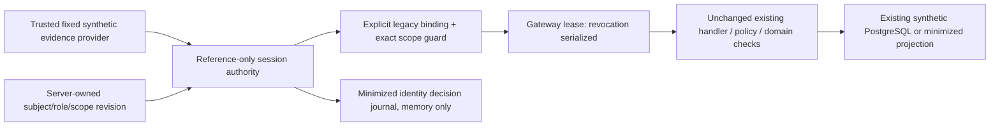

# Phase 2E — Synthetic identity/session architecture and threat model

**Synthetic contracts only. No production identity, login or integration.**

Baseline: `452b5bc702b336f919427de27ee4197a2fcf6d03`, fetched remote main including
merged PR #15 and readiness commit `51d91d0c49f7cbc9975476168f78414289212a20`.
Branch: `phase-2e/identity-session-contracts`. Initial tree was clean, seven
connectors disabled and no Mission Control runtime/credential resources active.

The [merged assessment](phase-2e-production-integration-readiness.md),
[decisions](phase-2e-ceo-decisions.md) and
[acceptance plan](phase-2e-acceptance-plan.md) remain authoritative. This scope
implements synthetic identity/session contracts and negative compatibility proofs
only. It does not resolve D01–D10 production choices or activate any readiness gate.
See the [contract specification](phase-2e-identity-session-contracts.md).

## Separation of responsibilities

- [identity_sessions.py](../mission_control/identity_sessions.py): immutable
  reference-only identity, entitlement, session policy/state and scope contracts;
  fixed deterministic test provider; bounded process-local session/replay state;
  minimized decision journal; explicit opt-in compatibility guard.
- [synthetic_identity.py](../mission_control/synthetic_identity.py): existing
  synthetic principal/MFA/service/policy/duty checks and exact grants still apply.
  An optional trusted `contract_guard` adds denial after those checks; it cannot
  create grants, approvals, keys or policy. All other custody behavior is unchanged.
- [connection_gateway.py](../mission_control/connection_gateway.py): with an
  installed guard, lease the session across the existing synchronous handler.
  The previous handler body is retained as `_handle`; domain/rate/audit/budget/
  projection/error behavior remains unchanged. Guard failure is sanitized.
- Existing HTTP bearer binding, browser cookies/CSRF, minimized Command Center
  projection, domain transactions, authorization/revision/approval rules and
  operational denial are reused. No new route, header, login, tenant selector,
  migration, persistence table, store, dispatcher or transport is added.



This is not a second domain registry. The new state is an ephemeral identity
session ledger, not business records or organizational policy. PostgreSQL is
exercised to prove existing domain behavior and rollback, not to persist sessions.
The complete existing 34-table archive/schema remains unchanged.

## Trusted installation and compatibility

A trusted installer supplies a fixed `DeterministicIdentityProvider`, known
`SubjectClaims`, `SessionPolicy`, UTC clock and bounded `DecisionJournal`.
Unknown/empty evidence or subjects deny issuance. The provider-neutral
`IdentityProvider` Protocol describes a future verified-reference boundary; it
performs no OIDC/OAuth/network verification. A production provider is deliberately
not accepted by this synthetic authority. Production claims/contracts/adapters
need separate design, key/issuer/custody decisions, independent tests and approval.
Never prefix real records with `syn-` to pass these contracts.

Legacy session references map server-side to an exact new session, stable subject,
tenant, session revision and existing policy revision. Action/resource scope
requirements are installed independently of requests. Subject, tenant and complete
role set must match the existing principal. Required department/team/executive
claims supplement, never replace, existing domain ownership and grant checks.

Default legacy fixture mode remains unchanged for compatibility. This does not
silently make the local operator a production login or globally enable the new
session layer. Opt-in guarded mode denies unbound sessions and unlisted actions.
The browser cannot select the guard, provider, subject mapping, roles or revisions.
Reauthentication increments the session revision; the trusted installer must
explicitly rebind the legacy session. A stale binding fails closed. No browser
reauthentication endpoint is introduced.

## Threat model and controls

| Threat | Control and test boundary |
| --- | --- |
| Email/address or provider subject substituted for internal identity | Stable opaque internal subject distinct from server-mapped external subject; strict ASCII reference shape; immutable tenant/provider/external mapping; exact legacy subject/roles match |
| Wrong issuer/provider/audience/tenant, missing MFA or malformed metadata | Trusted policy matches exact metadata; two distinct recognized synthetic factor claims, UTC validity, strict bounded JSON/unknown-field rejection; no client claims promoted into authority |
| Stale, expired, revoked, disabled or entitlement-changed session | Explicit session CAS revision, absolute/idle limits, subject snapshot/revision equality and revocation tombstone; no implicit resurrection or timeout fallback |
| Replay/duplicate session or challenge/receipt/request | Single-use provider receipt and challenge, never-reused session IDs within the authority, per-operation replay receipts, bounded fail-closed capacity; guards share authority-owned request sequencing |
| Privilege escalation | Existing ROLE_ACTIONS/PRIVILEGED vocabulary reused, server-held entitlements, exact action/resource requirements, existing policy deny precedence and self-approval controls remain mandatory |
| Sensitive action with stale authentication | Explicit sensitive scope requires authentication freshness; new receipt must prove later authentication for same subject/binding; reauth never extends original absolute deadline |
| Revocation races a mutation | One RLock linearizes checks, reauth, revocation and gateway leases. A request admitted before revocation may finish while revoker waits; after revocation returns all later guarded requests deny. No promise to cancel already committed work |
| Failure at audit or authorization boundary | Journal append precedes session/replay/activity change; sink/capacity failure denies without partial issuance, touch or revocation. Denied records contain no rejected input; failed domain operations roll back through existing services |
| Credential/token/data leakage | No credential/token/password/MFA-secret fields, network clients, cryptography or file writers. Opaque public fixture references are not bearer credentials. Audit excludes session IDs, provider evidence, challenges, methods and auth context |
| Cross-boundary bypass | Existing gateway/HTTP/UI tests retained; explicit guarded HTTP and cookie tests prove valid existing bindings cannot bypass contract revocation; DB/approval/migration grants still independently deny |

Trusted Python installation, the OS account, fixture clock and existing service
implementations are prerequisites. This is not a sandbox against malicious Python
code, and deterministic public references do not authenticate a real person.
MFA method/assurance metadata are synthetic assertions, not verified authenticators.
All actual production identity/custody decisions remain unresolved.

## Revocation, rollback, concurrency and restart semantics

The linearization point is the locked identity decision/state change. The gateway
holds the same reentrant lock through its existing handler and DB commit, so a
concurrent revoker waits for an already-admitted operation, then blocks subsequent
requests. Domain calls made directly by trusted Python outside that gateway lease
retain existing per-transaction/recheck behavior; callers needing whole-operation
serialization must explicitly use `guard.lease`. This layer is not a distributed
revocation service, hard deadline, durable transaction coordinator or preemption
mechanism. Existing cooperative timeouts and rollback remain in force.

The journal records admission decisions, not organizational approval or successful
domain commit. A domain rollback does not erase the fact that identity validation
occurred. Tests prove an actual uncommitted proposal exists before revocation and
that proposal/head/receipt/audit rows all roll back on failed commit recheck.
Audit failure leaves session/replay state unchanged. The monotonic observed-clock
watermark may advance on a denied attempt; it never grants authority.

`close()` clears subjects, sessions and replay state; subsequent use denies.
Restart discards all sessions. No persistence, cross-process revocation, durable
nonce store or cross-restart replay guarantee is claimed. A new trusted fixture
installation is a new test universe, not restoration of an old authenticated
session. Existing browser session invalidation and server-held bearer controls
remain unchanged. Memory capacity and audit exhaustion deny rather than evicting
security tombstones and silently accepting replays.

## Verification and operating boundary

Run the explicit offline demonstration:

```sh
python -B scripts/demo_identity_sessions.py --synthetic-development
```

It uses fixed UTC synthetic fixtures, performs issuance/validation, stale step-up
denial, reauth/revision, revocation and close, and prints only a constant summary.
It starts no listener, provider connection, container or database and creates no
credential, signing key, password or token. No session starts during imports.

Full verification uses the existing disposable PostgreSQL 17.11 pattern and every
existing test, plus new offline and actual-DB cases. Existing baseline test files
are unchanged. Actual counts, failures/cleanup, dependency/demo/browser/schema/
workflow/link/leakage/legacy-log/whitespace evidence and exact file hashes are
recorded in `/workspace/phase-2e-identity-review/`; no historical count is forced.
Existing test custody fixtures remain unchanged synthetic HMAC proofs; this layer
introduces no signing/encryption keys or production credential creation.

No confidential records, production data, provider selection/client, connectors,
HubSpot/Slack/2nd Brain connectivity, deployment or later Phase 2E component is
implemented. All seven connectors remain disabled. No operational authority is
issued. Manual assistive-technology and macOS qualification, real IdP/MFA/session
security, multiworker durability, production audit custody and service SLOs remain
future separately approved work. Keep this diff uncommitted/unstaged for CEO review.
