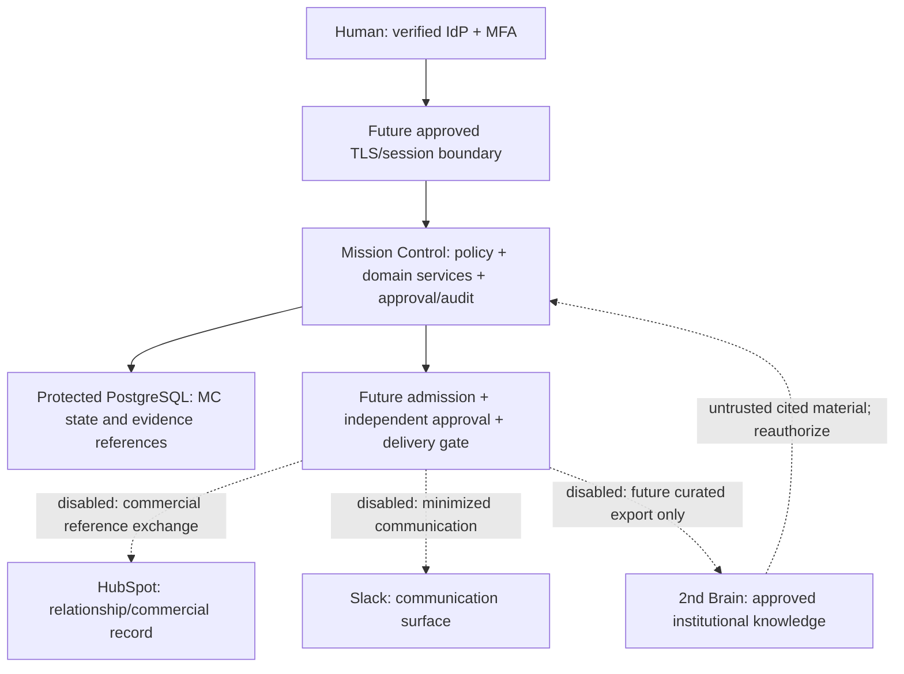

# Phase 2E — Production-readiness and integration assessment

**Assessment and design only. Production and integration activation remain blocked.**

Assessment date: November 12, 2026, America/Chicago. Planning horizon: November 30,
2026. Baseline: `b20faa9fb588c18e4f63785466dfcde43d521c0c`, fetched remote `main`.
This merge names PR #14 and has Phase 2D commit
`d85e746c46a929a5e721398e7a3d59590cdad68e` as its second parent. The initial
working tree was clean. Assessment branch: `phase-2e/production-integration-readiness`.

This phase changes documentation only. No implementation, workflow, dependency,
migration, runtime configuration or operational record changes are authorized.
No service, listener, container, vendor account, identity, credential or connection
is created or activated. No confidential data, record migration or 2nd Brain
implementation is permitted. This plan is ready for review only when its evidence
and limitations are complete; it cannot itself authorize implementation or launch.

## Review map

1. This architecture, authority and boundary assessment.
2. [Seven-connector inventory and activation matrix](phase-2e-connector-gates.md).
3. [Security/production-readiness gap assessment](phase-2e-security-gaps.md).
4. [HubSpot and 2nd Brain integration impact](phase-2e-integration-impact.md).
5. [Prioritized roadmap through November 30](phase-2e-roadmap.md).
6. [Future acceptance-test and rollback plan](phase-2e-acceptance-plan.md).
7. [CEO decision register and next branch](phase-2e-ceo-decisions.md).

The durable review package is `/workspace/phase-2e-review/`. It contains the
baseline, read-only validation transcript, findings, complete documentation diff,
exact file hashes and CEO review summary. It is not a deployed environment or a
backup guarantee across VM loss. No PR, commit or push is part of this assessment.

## Evidence and confidence boundary

Source inspection at the exact baseline is the primary evidence. Relevant sources:
[readiness.py](../mission_control/readiness.py),
[synthetic_identity.py](../mission_control/synthetic_identity.py),
[registry_authorization.py](../mission_control/registry_authorization.py),
[connection contracts](../mission_control/connection_contracts.py),
[gateway](../mission_control/connection_gateway.py),
[domain adapter](../mission_control/connection_services.py),
[local HTTP boundary](../mission_control/local_http.py),
[CEO interface](../mission_control/command_center_ui.py),
[operator](../mission_control/local_operator.py),
[synthetic PostgreSQL](../mission_control/synthetic_postgres.py),
[34-table archive](../mission_control/pilot_archive.py),
[archive integrity](../mission_control/pilot_archive_integrity.py),
[audit](../mission_control/audit.py) and
[provider adapter](../mission_control/providers.py).

Earlier technical verification is historical evidence, not a new test execution
or production proof. This assessment does not run the application, demonstrations,
PostgreSQL suites, vendor calls or browser. It does not verify live provider
contracts, pricing, permissions, regions, SLOs, recovery, security configuration or
account entitlements. Vendor-specific permissions below are proposed candidates;
they require current official-documentation and account-specific verification
before implementation/activation. Missing evidence remains missing, not assumed.

## Current baseline versus proposed production target

| Concern | Observed implementation | Production target, not implemented |
| --- | --- | --- |
| Operating structure | Existing INFORMATION → INTELLIGENCE → DECISION → ASSIGNMENT → EXECUTION → MEASUREMENT projections; immutable original classification and append-only history | Preserve one domain system and exact authorized views; bind real ownership and approval authority |
| Identity | Server-installed synthetic sessions, MFA flags and fixture policies; no real login/IdP | Individually attributable verified identities, MFA, lifecycle/revocation and independent policy mapping |
| Presentation/transport | Disabled by default; literal loopback; ephemeral local UI; process-local sessions and strict browser controls | Separately approved authenticated TLS service design with explicit proxy trust; never rebind the fixture server to a LAN/public address |
| Persistence | Synthetic-only PostgreSQL constraints, tenant/resource checks, CAS, approvals, transactional audit, forced RLS | Protected hosting, nonprivileged runtime, real tenant policy, encryption, availability and tested recovery |
| Keys/archives | Process-local synthetic HMAC; complete synthetic archive/restore | Independent durable signing/encryption custody and encrypted, witnessed backup/PITR |
| Outbound integration | Seven disabled descriptors; unconditional operational denial; transient inactive intentions | Reviewed durable delivery contracts and independently approved per-connector transport, not a flag flip |
| Operations | Local managed lifecycle and synthetic tests | Named accountable operators, monitoring/on-call, incident response, retention and change control |

The production identity/storage boundary is not a drop-in configuration change:
there are explicit `SyntheticAuthority` type checks, `syn-` references, synthetic
classification/state constraints and unconditional operational-denial paths.
Do not remove those checks or relabel real records as synthetic. Any future
production authority/adapter needs an independently reviewed versioned contract,
negative tests and compatibility plan preserving the current local evaluation mode.
No production schema or authority is designed into executable files in this phase.

## Authority: one system, five distinct responsibilities

| System | Approved/proposed authority | Must not become authoritative for |
| --- | --- | --- |
| Mission Control OS | Governed policy, decision/approval references, work ownership, dependencies, lifecycle and authorized operational interpretation | External commercial facts it does not own; unverified knowledge or chat claims |
| PostgreSQL | Durable authoritative persistence for Mission Control state, versions, grants, evidence bindings, receipts and audit within approved schemas | Independent business decisions or a second operating system; direct browser access |
| HubSpot | **Approved relationship/commercial record**: designated contact/company/deal fields and commercial owner-controlled facts | Mission Control policy, approval authority, task completion, identity/MFA or department authorization |
| Slack | **Approved communication surface**, scoped notifications and human discussion | The operating system, durable approval ledger, workflow engine or source of final operational truth |
| 2nd Brain | **Proposed approved institutional knowledge** with provenance, version, classification and ACL | Live operational truth, transaction state, identity, routing policy or approval authority |

Field-level ownership beats a vague global “single source of truth.” An external
fact can be authoritative in its own domain without authorizing a Mission Control
action. PostgreSQL stores the governed state; Mission Control services interpret
it. Neither a Slack message nor a knowledge answer can directly update it.

## Proposed future trust-boundary diagram

All integration arrows below are design proposals and remain **disabled**. No
new client, dispatcher, webhook, vector database or account is implemented here.

Current local synthetic UI/gateway/service paths remain unchanged; the future
boundary is not a proxy/tunnel around that fixture server. Direct browser ↔ DB,
browser ↔ vendor credentials, Slack ↔ DB and knowledge ↔ domain mutation are
forbidden designs. Infrastructure products and a production hosting model remain
CEO decisions; this diagram does not purchase or provision them.

## Production identity, authorization and session design requirements

- Choose a supported enterprise OIDC identity provider and approved issuer,
  audience, client, tenant membership and administrator ownership. Verify signed
  tokens, algorithm allowlist, key rotation/JWKS freshness, expiry/not-before,
  state/nonce and authorization-code/PKCE flow. Deny unknown keys/issuers, replay,
  tenant confusion and unavailable verification. No browser-provided role claims.
- Require phishing-resistant MFA for privileged and approval actions; propose it
  for all users. Privileged step-up freshness, recovery, offboarding, revocation,
  emergency access and authenticator resets need independently witnessed tests.
  Synthetic `mfa_verified` is not an MFA implementation.
- Map immutable verified subjects to server-owned tenant/resource/department grants
  and current policy revisions. IdP membership alone never approves a business
  action. A CEO title is not a universal technical-admin or cross-tenant grant.
- Propose a server-side session boundary: browser holds only opaque short-lived
  HttpOnly/Secure/SameSite cookies; CSRF/origin checks for mutations; no bearer,
  refresh or IdP token in HTML, URLs, browser storage, telemetry or logs. Server
  session rotation, fixation protection, logout/revocation and concurrent-session
  policy are required. Actual lifetimes are decision D02, not existing settings.
- Machine identities are per environment/connector, short-lived and unable to
  impersonate human approvals. Reauthorize queued operations at dispatch time,
  not just at intake. Deny stale/revoked policy and unresolved dependencies.
- Current synthetic controls remain intact while future interfaces are reviewed.
  Public network exposure, new authentication code or transport changes require
  separate authorization; none is part of this assessment.

## Production data, storage and operation design requirements

The [gap assessment](phase-2e-security-gaps.md) maps all twelve existing readiness
controls to concrete owners, missing proof and acceptance tests. Require private
DB connectivity, verified TLS, encryption for primary/replica/backups, independent
key custody, least-privilege runtime/migration/restore roles, forced tenant
isolation, tested pool/context reset and timeouts. Do not repurpose the disposable
trust-auth test cluster as production or accept a cloud DSN as proof of safety.

Candidate sizing targets, **not commitments**: RPO ≤15 minutes, RTO ≤4 hours and
99.9% monthly production availability. Region, service window, coverage, provider,
backup retention and budget must be approved before these can become SLOs. If
24/7 operational ownership is unavailable, choose a separately defined restricted
service window instead of claiming 24/7 availability. A JSON export or same-process
HMAC verification is neither encrypted backup nor PITR nor independent proof.

Confidential-data admission remains entirely denied now. Future admission must
specify lawful purpose, exact fields, subjects/consent, owner, classification,
tenants, recipients, regions, retention, legal holds, erasure and vendor/model
processing. An opaque external ID or embedding can still be personal/confidential
data; a `syn-` prefix never sanitizes it. Legacy logs are not a migration source.

## Approval, automation and rollback principles

No health check, model confidence, technical test, webhook, commercial record,
Slack reaction or knowledge citation is organizational authorization. Future
mutation approval binds an exact action, target/account, fields, recipient,
expected revision, purpose, policy/evidence revisions and expiry; material changes
invalidate it. Author, approver, deployer and credential custodian must be
appropriately separated. Approval and dispatch are separate checks.

Existing inactive outbox intentions are not durable queued delivery. Future
transactional delivery storage would require separate schema/archive/retention
review, encrypted/minimized payload references, stable idempotency, leases/fencing,
bounded retries, reconciliation and kill switches. Exactly-once cross-system
execution must not be promised. Unknown acknowledgments require reconciliation;
blind retry or “undo” can duplicate or compound harm. External compensation needs
a new human approval; email/publication cannot be reliably recalled.

The [acceptance plan](phase-2e-acceptance-plan.md) makes these conditions testable.
The [roadmap](phase-2e-roadmap.md) limits November 30 commitments to feasible,
separately approved offline/synthetic work. The 2nd Brain is outside the critical
path and must not be implemented under this assessment or the proposed next branch.

## M2 design follow-up

The [storage/recovery/audit design](phase-2e-storage-recovery-audit-design.md)
and [nine synthetic tabletop cases](phase-2e-operations-tabletop.md) document
roadmap M2 after merged PR #16. They add no executable behavior or production
evidence; hosting, custody, staffing, admission and restart remain blocked.

## M3 fictional contract follow-up

The [M3 mock](phase-2e-hubspot-mocked-projection.md) adds process-local fictional
contact/company projection contracts and offline negative tests only. M1/M2
boundaries, exact operational denial and all seven disabled connectors remain.
No real HubSpot read, credential, data admission or vendor proof is supplied.

## M4 protected evidence review

The [M4 evidence index](phase-2e-readiness-evidence-review.md) binds merged M1–M3
to baseline `b83916755bcaec29526e01f9d64ad1231c4540af`, distinguishes local
historical execution, design/tabletops, public status, CEO-reported screenshot
counters and unavailable authenticated logs, and prepares M5 without deciding it.
No production acceptance, organizational authority or connector gate is closed.
