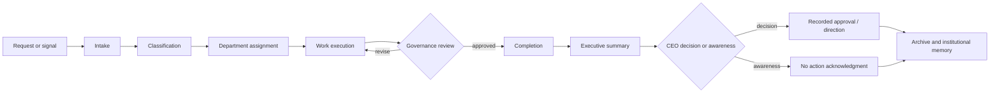

# CEO Desk Information Flow

## Status and design boundary

The repository currently supports only **directive → one route → one generated output → narrow governance check → optional local record**. The broader lifecycle below is a **PROPOSED STANDARD — NOT APPROVED OR IMPLEMENTED**. Evidence for the current path: `mission_control/engine.py` (`run`); `mission_control/providers.py` (`MockProvider`); `mission_control/audit.py`.

## Proposed operating rules

| Question | Proposed rule | Current support |
|---|---|---|
| What enters? | Directives, customer/guest/partner signals, deadlines, risks, exceptions, completed work, metrics—with source, owner, sensitivity, due date | Free-text directive only |
| Classification | Type, department(s), urgency, sensitivity, decision/awareness, system of record | One keyword-selected department |
| Assignment | Create accountable owner, acceptance timestamp, due date, dependencies, approval path | Not implemented |
| Department return | Outcome, evidence, unresolved issues, risks, next step, approvals, record links | Generic template only |
| CEO approval | External representation; final guest/release; sensitive relationship; sponsorship/compensation/legal/public commitments; governance exceptions; priority conflicts | Text says CEO final approval; no enforcement |
| CEO awareness | Routine approved completions, stable KPI trends, upcoming work within policy | Not implemented |
| Weekly report | Changes, decisions, completed/in-progress/waiting/at-risk/blocked, relationships, opportunities, risks, KPIs, seven-day look-ahead | Not implemented |
| Audit log | Directive/source reference, route, actor/provider, timestamps, review findings, revisions, approval identity/outcome; minimize sensitive payloads | Full directive/output JSONL only |
| CRM | Relationship identity, consent/contact preferences, provenance/referral, lifecycle/status, interactions, commitments links | Not implemented |
| Podcast tracker | Episode/guest IDs, production stage, asset/consent readiness, recording/release dates, owner, holds, approvals, channel links | Not implemented |
| Alert | Deadline breach, governance failure, missing approval/consent, conflicting source, sensitive relationship, material risk, system failure | Not implemented |
| Keep from CEO Desk | Routine task chatter, duplicates, raw drafts, healthy reminders, low-risk details within delegated policy; retain in team system | Not implemented |

## Decision versus awareness gate

**Decision required:** a named option, deadline, recommendation, consequence of delay, evidence links, and accountable requester.
**Awareness only:** material change or completion with no requested action; state why it matters.
**Do not escalate:** routine work within approved thresholds unless overdue, blocked, anomalous, or relationship-sensitive.

## Proposed CEO Desk output schema

> **PROPOSED STANDARD — NOT APPROVED.** The implemented prototype requires only four headings and does not store these fields structurally.

| Field | Minimum content |
|---|---|
| Executive Summary | Time-boxed synthesis; what changed and why it matters |
| Major Decisions | Decision, owner, date, rationale/source |
| Completed | Outcome, owner, evidence, downstream update |
| In Progress | Owner, next milestone, due date, confidence |
| Waiting | Dependency, dependency owner, follow-up date |
| At Risk | Risk, probability/impact, mitigation, trigger |
| Blocked | Blocker, age, required decision/action |
| Relationships Requiring Attention | Minimal sensitive summary; restricted detail link |
| Opportunities | Evidence, value hypothesis, next validation step—not a commitment |
| Risks | Operational, data, governance, brand, security, commercial |
| KPIs | Approved definition, source, period, target, actual, quality note |
| Decisions Required | Options, recommendation, deadline, consequence |
| Next Seven Days | Milestones, approvals, relationship moments |
| Implementation Progress | Capability status: current/partial/planned/conceptual/blocked/unknown |

## Archive and institutional memory requirements (recommendation)

Use stable IDs, source links, owner, classification, timestamps, approval evidence, retention class, and supersession links. Do not put secrets or unnecessary private content into executive summaries or general audit logs. CRM, tracker, and audit log should reference rather than duplicate sensitive records whenever possible.
