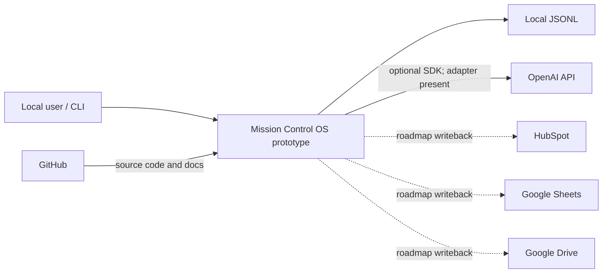

# Technology Stack and Integration Map

> **Confirmed** means repository evidence exists; it does not mean production deployment. Planned methods/tools remain recommendations until approved.

| Platform | Current / planned purpose | Confirmed use | Data owned / received / sent | Integration/auth | Governance / source-of-truth / duplication | Status |
|---|---|---|---|---|---|---|
| Mission Control OS™ | Directive routing, generation, review, local record | Python CLI mock tested | Receives directive; emits record; owns local execution record only | Local CLI; none | Full payload logs; not enterprise SOR | **CURRENT prototype** |
| OpenAI API | Live classification/generation | Adapter + fake-client test; no live proof | Receives directive/catalog/mandate; returns route/text | SDK Responses API; API key env | Vendor data handling, validation, cost; not SOR | **PARTIAL** |
| ChatGPT | Development/reasoning narrative | README statement only | **UNKNOWN** | **UNKNOWN** | Do not equate with runtime | **UNKNOWN operationally** |
| GitHub | Source control | Git repository/history confirmed | Code/docs | Git credentials outside repo | Protected assets/branch rules unknown; code SOR | **CURRENT** |
| Local JSONL | Execution audit prototype | Writer/tests confirmed | Full directive, route, output, result | Filesystem | Privacy/integrity/retention; duplicate of source content | **CURRENT prototype** |
| HubSpot | CRM/writeback | README says writeback roadmap | Intended relationship data **UNKNOWN** | **UNKNOWN**; likely OAuth/private app only after decision | CRM SOR unresolved; duplicate Sheets risk | **PLANNED** |
| Google Sheets | Staging/tracking/writeback | README says writeback roadmap | **UNKNOWN** | **UNKNOWN** | Weak controls/duplication risk | **PLANNED** |
| Google Drive | Asset storage/writeback | README says writeback roadmap | **UNKNOWN** | **UNKNOWN** | Rights/access/retention risk | **PLANNED** |
| Google Calendar | Scheduling | No evidence | **UNKNOWN** | **UNKNOWN** | Calendar SOR unresolved | **UNKNOWN** |
| Gmail | Intake/follow-up | No evidence | **UNKNOWN** | **UNKNOWN** | High privacy/representation risk | **UNKNOWN** |
| Calendly | Booking | No evidence | **UNKNOWN** | **UNKNOWN** | Calendar duplication/consent | **UNKNOWN** |
| Zapier | Automation | No evidence | **UNKNOWN** | **UNKNOWN** | Credential sprawl, opaque retries | **UNKNOWN** |
| Airtable | Tracker/database | No evidence | **UNKNOWN** | **UNKNOWN** | HubSpot/Sheets duplication | **UNKNOWN** |
| StreamYard | Recording | No evidence | **UNKNOWN** | **UNKNOWN** | Media rights/storage | **UNKNOWN** |
| Podcast hosting/distribution | Publish episode | No vendor/config supplied | **UNKNOWN** | **UNKNOWN** | Release authority/metadata | **UNKNOWN** |
| LinkedIn | Distribution | Potential content output in README, no integration | **UNKNOWN** | **UNKNOWN** | Public representation | **CONCEPTUAL/UNKNOWN** |
| YouTube | Distribution | No repository evidence | **UNKNOWN** | **UNKNOWN** | Public representation/rights | **UNKNOWN** |

## Integration diagram

Solid lines are confirmed code paths. Dashed lines are README-stated roadmap connections. Unknown platforms are intentionally not connected.

## Decisions before integration

Rob and CJ should establish system-of-record ownership, stable IDs, data classification/consent, minimum payloads, authentication ownership/rotation, environment separation, retry/idempotency, reconciliation, audit/retention, error queues, approval gates, and decommissioning of duplicate trackers. No platform recommendation in this document is an approved architecture decision.
